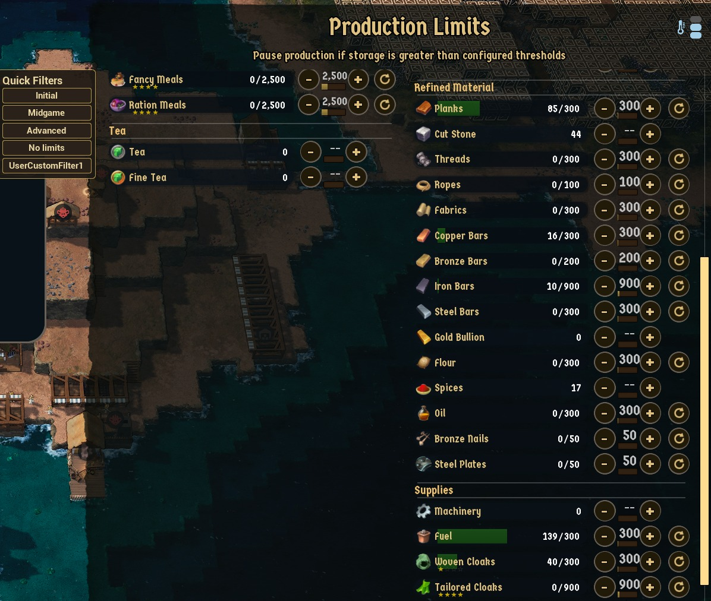

# Production Limit Profiles

A quality-of-life mod for [Whiskerwood](https://store.steampowered.com/app/2489330/Whiskerwood/).



The Production Limits window makes you click + and − on every resource, and your limits change as the colony grows. This mod adds a **Limit Profiles** list beside the window: *Initial*, *Midgame*, *Advanced*, *No limits*, plus **your own profiles**. One click sets every limit in the profile.

## Features

- Profiles **set** limits: each listed resource gets that limit; resources a profile doesn't mention keep theirs (unless the profile starts with `* = off`).
- Make your own profiles, or **replace / remove the built-in ones**, in a text file: single resources, whole categories (`@ore`) or everything (`*`), a number or `off`.
- Uses the window's own limit actions (the same ones its + / − and reset buttons send), so nothing is patched and saves stay normal.
- Setting under **Settings → Mods**: *Production Limit Profiles - profile list* (on by default).
- Works while paused, and does nothing in the background: the mod only reacts to your clicks and key presses.

## Installing

- **Steam Workshop:** subscribe.
- **Manually:** put `ProductionLimits.pak` and `ProductionLimits.uplugin` in `%localappdata%\Whiskerwood\Saved\mods\ProductionLimits\`.

## Your own profiles

Every resource id, every category key and the built-in profiles (to copy from) are in [`docs/ProductionLimits-defaults.txt`](docs/ProductionLimits-defaults.txt).

### The file

1. Create the folder `%localappdata%\Whiskerwood\Saved\mods\ProductionLimitsConfig\` (a separate folder, so mod updates never touch your file).
2. Save a text file **`ProductionLimits.txt`** there (watch out for `ProductionLimits.txt.txt` when Windows hides extensions).
3. Load your save (or start a new game). The file is read then; after editing it, load again.

### A profile

A line in `[brackets]` starts a profile: the text is the button label. Then one `what = limit` per line.

```ini
[Farm only]
* = off            ; clear every limit first...
wheat = 200        ; ...then set these
@rawFood = 2500
```

| Left of `=` | Means |
|---|---|
| `wood`, `copperore`, ... | one resource (the ids aren't always the window names: Logs = `wood`, Cut Stone = `bricks`, Hardtack = `basicRations`, ...) |
| `@rawFood` `@foodTier1` `@preparedFood` `@mealFood` `@tea` | Raw Food, Cooked Food, Prepared Food, High Cuisine, Tea |
| `@raw` `@ore` `@refined` `@tools` `@naval` `@trade` | Raw Material, Ores, Refined Material, Supplies, Naval, Export Goods |
| `*` | every resource in the window |

| Right of `=` | Means |
|---|---|
| a number | production pauses while storage holds more than this (`0` is allowed) |
| `off` (or `-`, `--`, `none`, nothing) | no limit, like the window's reset button |

- Clicking a profile changes **only the resources it lists**; everything else keeps its current limit. Start with `* = off` to make a profile a complete setup (the built-in ones do).
- Lines apply top to bottom and **a later line wins**: `* = off` then `wood = 50` clears everything except Logs; `@ore = 100` then `goldore = off` limits every ore except gold.
- Resources the window doesn't list (not unlocked yet, or a typo) and limits that aren't numbers are skipped.
- Upper/lower case and spaces don't matter. `;` or `#` starts a comment, also at the end of a line. Empty lines are fine; lines before the first `[profile]` are ignored.

### Changing the built-in profiles

*Initial*, *Midgame*, *Advanced* and *No limits* come first; your file is read after them, top to bottom.

```ini
[Initial]          ; same name as a built-in: REPLACES it completely (it keeps its place in the list)
* = off
berries = 2500
planks = 300

[Advanced]         ; nothing under it: REMOVES that button

[Farm only]        ; any other name: a NEW button, after the built-in ones
wheat = 200
```

- **Replace:** your version replaces the built-in one completely, nothing of it is kept. Easiest: copy its block from the end of the defaults file and edit the numbers.
- **Remove:** the name with no lines under it.
- **Rename:** remove it, then add your own profile under the new name.
- **Add:** new buttons appear after the built-in ones, in your file's order.
- The same name twice in your file: the later one wins.

### Tips

- **Copy your current limits:** put any text in `ProductionLimitsConfig\debug.txt`, load your save and open the Production Limits window. `Saved\Logs\modlog.txt` then lists every resource as `id = limit` (after a date and the mod name; resources without a limit may show a number, write `off` for those). Delete `debug.txt` again when done.
- Production limits need an assigned administrator; without one the game ignores the changes.
- The list can be hidden under **Settings → Mods** (*Production Limit Profiles - profile list*).

## Repository layout

| Path | What |
|---|---|
| `Mod/ProductionLimits/` | The mod's source assets (`.uasset`) and `ProductionLimits.uplugin`. |
| `docs/graphs/` | Blueprint graphs as copy-paste text (T3D). Reference only: the `.uasset` files are the source of truth. |
| `docs/ProductionLimits-defaults.txt` | Built-in profiles, format, all resource ids and category keys. |
| `tools/` | `t3d.py`, `pl_common.py`, `pl_build.py` (graph generator), `profiles_sim.py` (Python mirror of the config parser, with tests). |
| `workshop/` | SteamCMD item file and [upload steps](workshop/HOW_TO_UPLOAD.md). |
| `sync-from-modkit.bat` / `sync-to-steam.bat` | Copy assets from the modkit + stage the pak / upload to the Workshop. |

## Building from source

1. Set up the [Whiskerwood modkit](https://github.com/Whiskerwood-Modding/Whiskerwood-Project) (UE 5.8).
2. Copy `Mod/ProductionLimits/` to `Content/Mods/ProductionLimits/`. Pak chunk **29** (`PAL_ProductionLimits`).
3. **Cook & Install**; afterwards `sync-from-modkit.bat` copies changed assets back.

Regenerate graphs with `JMAP=path/to/Whiskerwood-x.jmap.gz python tools/pl_build.py` (output in `tools/out/`, with `variables.txt`). In each graph: Ctrl+A, Delete, Ctrl+V, compile.

| Asset | Parent class | Variables / designer |
|---|---|---|
| `BP_Startup` | Actor | none |
| `WBP_LimitHelper` | **ProductionControls** | `Hud` (Production Control State UI), `Keys`, `SlotKeys`, `ItemNames` (Name arrays), `ItemCats` (String array), `Limits` (Integer array), `Unlocked` (Boolean) |
| `WBP_LimitWaiter` | UserWidget | `Waited` (Float), `Stage` (Integer), event dispatcher `Done` |
| `WBP_LimitButton` | UserWidget | designer: **Button `Btn`** → **Text `Label`** |
| `WBP_LimitPanel` | UserWidget | designer: **Border** (root) → VerticalBox → title Text + **VerticalBox `List`** |
| `BP_MapLoad` | Actor | see `tools/out/variables.txt` |

Paste order: the designer widgets, `WBP_LimitWaiter` (create `Done` first), `WBP_LimitHelper`, `BP_Startup`, `BP_MapLoad`.

## How it works

- The Production Limits window is the game's `ProductionControls` (`Arcoview_ProductionControls`). Its private `CalcState()` returns the categories, resources and current limits (`minHold`); an invisible helper widget (a child class of the window) reads it. If that read is empty, the mod uses the game's `Resources` table.
- Each row's number control sends the game action `setProductionLimit` (resource + value), its reset button `clearProductionLimit`. The mod sends the same actions through the window's category widgets, the way a click travels; a limit that already has the wanted value is skipped.
- **When the mod runs:** after a key / mouse release, a HUD action (such as the one that opens the window), or a click on one of the window's buttons, an invisible widget waits a moment (widget tick, so it works while paused), then the mod looks for an open Production Limits window. The window slides in, so the list is shown once it has stopped moving. Nothing runs between clicks.

## Debug logging

Silent by default. Create `%localappdata%\Whiskerwood\Saved\mods\ProductionLimitsConfig\debug.txt` with any text to get log lines in `%localappdata%\Whiskerwood\Saved\Logs\modlog.txt`. With it on, opening the window also logs your current limits as `id = limit` lines (see Tips above).

## Known limitations

- Production limits need an assigned administrator (the window says so); without one the game ignores the changes.
- The game applies the changes through its normal command queue, so the numbers update a moment later.

## Version history

- **1.0**: first release.

## Credits

Created using the Whiskerwood modkit: https://github.com/Whiskerwood-Modding/Whiskerwood-Project
